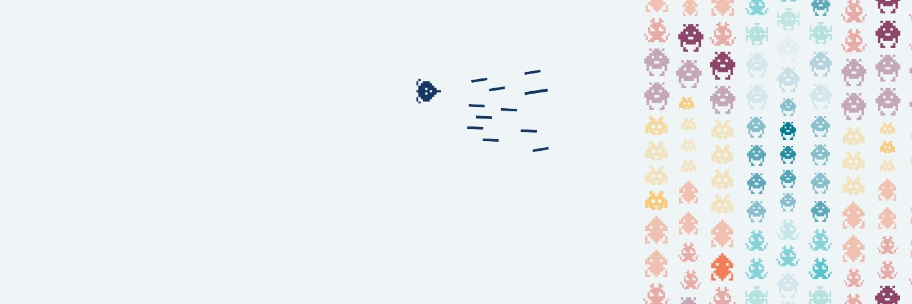

<p align="left">
  <picture>
    <source
      media="(prefers-color-scheme: dark)"
      srcset=".github/assets/readme-banner_dark.jpg"
    />
    
  </picture>
</p>

<p align="right">auth a project by REVREBEL</p>

# AUTH

REVREBEL's browser authentication bridge for Webflow.

The app is intentionally small: Webflow Cloud installs and bundles the Kinde JavaScript SDK, then ordinary Webflow pages load one stable browser asset and talk to `window.REVREBELAuth`.

## Architecture

```text
Webflow Designer page
        |
        | <script src="/auth/assets/revrebel-auth.js">
        v
REVREBELAuth browser bridge
        |
        | @kinde-oss/kinde-auth-pkce-js
        v
Kinde (Authorization Code + PKCE)
```

The browser application never receives or stores a Kinde client secret. Configure the Kinde application as **Front-end and mobile**.

## Webflow Cloud

Deploy this repository as a Vite application and mount it at:

```text
/auth
```

`webflow.json` declares the Vite framework. Webflow Cloud supplies the environment mount path during deployment.

The browser bundle is built to a stable path:

```text
/auth/assets/revrebel-auth.js
```

## Webflow embed

Add the public Kinde values before loading the bundle:

```html
<script>
  window.REVREBEL_AUTH_CONFIG = {
    clientId: "YOUR_KINDE_CLIENT_ID",
    domain: "https://auth.revrebel.io",
    redirectUri: "https://www.revrebel.io/client-hub",
    logoutUri: "https://www.revrebel.io/"
  };
</script>

<script
  type="module"
  src="/auth/assets/revrebel-auth.js">
</script>
```

The client ID and Kinde domain are public browser configuration. Do not put a Kinde client secret in Webflow.

## Browser API

```js
await REVREBELAuth.ready();

await REVREBELAuth.login();
await REVREBELAuth.register();
await REVREBELAuth.logout();

const authenticated = await REVREBELAuth.isAuthenticated();
const user = await REVREBELAuth.getUser();
const profile = await REVREBELAuth.getUserProfile();
const token = await REVREBELAuth.getAccessToken();

await REVREBELAuth.portal({
  returnUrl: window.location.href
});

await REVREBELAuth.createOrganization({
  app_state: {
    redirectTo: window.location.href
  }
});
```

For calls to Webflow Cloud APIs, `REVREBELAuth.fetch()` automatically attaches the current access token as a Bearer token:

```js
const response = await REVREBELAuth.fetch("/dashboard/api/me");
```

## Events

The bridge emits a `revrebel:auth` browser event for redirects, restored sessions, and auth errors.

```js
window.addEventListener("revrebel:auth", (event) => {
  console.log(event.detail);
});
```

## Local development

```bash
npm install
npm run dev
```

Validate production output with:

```bash
npm run typecheck
npm run build
```

## Kinde application

Use a Kinde **Front-end and mobile** application with Authorization Code + PKCE.

At minimum, add the Webflow URLs you use as:

- Allowed callback URLs
- Allowed logout redirect URLs
- Allowed origins

For production session restoration, use the Kinde custom domain on the REVREBEL domain, e.g. `auth.revrebel.io`.

## Project tree

```text
.
├── index.html
├── package.json
├── src/
│   └── revrebel-auth.ts
├── tsconfig.json
├── vite.config.ts
└── webflow.json
```
